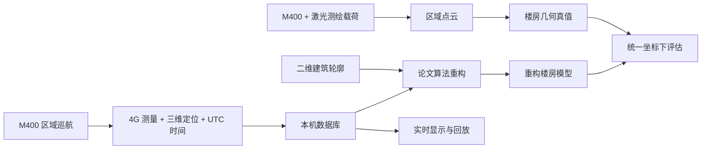

# UAV Radio Mapping

基于无人机蜂窝信道测量的三维楼房地图重构，使用激光点云建模作为评估真值。

本项目延续 *Prototype of Joint CKM and 3D Environment Reconstruction System via UAV RF Measurements* 的实验基础。计划使用 DJI Matrice 400（M400）完成区域测绘，建立建筑几何地图，再在同一区域巡航，联合记录 4G 信道测量、三维位置和时间，按论文算法重构楼房高度并验证效果。目标是轻量、可复现的开源实验系统。

论文稿件：[Prototype of Joint CKM and 3D Environment Reconstruction System via UAV RF Measurements（PDF）](docs/papers/Prototype_of_Joint_CKM_and_3D_Environment_Reconstruction_System_via_UAV_RF_Measurements.pdf)。后续算法重构以此稿件为依据。

**当前阶段：本地几何数据库与无线测量接收。** 已实现 SQLite 几何存储、合成示例，以及无线 JSON 接收、服务器长期保存与电脑同步、可选 HTTPS 中转和 Windows 桌面控制。定位/实验原点条件不齐的测量先可靠暂存；接收成功不等于已导入标准观测表。点云处理、历史定位补齐、回放与论文算法重构仍待后续开发。

接收程序和部署步骤见 [接收与中转说明](docs/radio-receiver.md)，源码位于 [`tools/radio_receiver/`](tools/radio_receiver/)。配置模板不含真实地址、认证密钥、采集记录或 DJI 应用凭据。

## 快速开始

要求 Python 3.10+，SQLite 支持 RTree。核心运行使用 Python 标准库，无需数据库服务器、ROS 或容器。

```bash
git clone https://github.com/zxyyz/uav-radio-mapping.git
cd uav-radio-mapping

# 创建实际实验用的空数据库
python3 run.py init
python3 run.py status

# 在独立数据库中运行合成示例：3 栋楼房，不代表真实测绘结果
python3 run.py --db data/geometry/demo.sqlite3 demo
python3 run.py --db data/geometry/demo.sqlite3 buildings synthetic-v1 --bbox 0 0 40 40
python3 run.py --db data/geometry/demo.sqlite3 export-buildings synthetic-v1 data/derived/demo-buildings.json
```

默认数据库为 `data/geometry/maps.sqlite3`。`--db` 放在子命令前；路径相对于执行命令时的当前目录。同一地图重复导入不会产生重复记录；修改模型时应使用新的 `map_id`。

导入自有建筑模型：

```bash
python3 run.py import-buildings path/to/buildings.json
```

输入格式参考 [合成模型](src/uav_radio_mapping/demo-buildings.json) 和 [数据约定](docs/data-contract.md)。使用以 WGS84 椭球高原点定义的局部 ENU 米制坐标；当前版本不负责点云提取或坐标转换。

测试与可选安装：

```bash
python3 -m unittest discover -s tests -v
# 若需要 uav-map 命令，可在自己的虚拟环境中安装
python3 -m pip install -e .
```

## 实验流程



初期几何模型为“二维多边形轮廓 + 地面基底高程 + 楼高”的挤出体。激光真值、二维先验与 RF 重构使用独立地图版本；重构输入不含真值楼高。M400 飞行平台与激光测绘载荷分别配置，对接方式在硬件集成阶段确定。

## 仓库内容

| 路径 | 用途 |
| --- | --- |
| `src/uav_radio_mapping/` | 标准库 CLI、SQLite 模式与几何模型存储 |
| `docs/papers/` | 原型论文稿件 |
| `docs/background.md` | 原型工作与现有资料梳理 |
| `docs/architecture.md` | 轻量系统结构与本地存储布局 |
| `docs/data-contract.md` | 坐标、时间、几何与测量约定 |
| `docs/roadmap.md` | 后续开发阶段与验收目标 |
| `docs/experiment-protocol.md` | 测绘、巡航、重构及真值评估流程 |
| `tests/` | 数据完整性、空间查询与 CLI 测试 |
| `tools/radio_receiver/` | 无线测量接收、中转、配置模板与 Windows 控制 |
| `data/` | 本地数据库、原始点云、日志与输出，Git 忽略 |
| `local/` | 本机来源路径、资料索引与本地配置，Git 忽略 |

仓库发布新代码、文档、合成数据和原型论文稿件。地图瓦片、硬件设计与实测数据保留本地，按需另行整理可发布的数据集。新仓库代码采用 [MIT License](LICENSE)；论文稿件保留原有版权，不适用代码的 MIT 许可。

English: a lightweight, local-first UAV radio mapping project with a dependency-free SQLite geometry store, synthetic examples, and radio-packet reception/relay tools. Measurements without the required pose and site remain durably staged rather than being inserted with fabricated coordinates. Planned work covers point-cloud processing, replay, and paper-based building-height reconstruction validated against LiDAR geometry.
